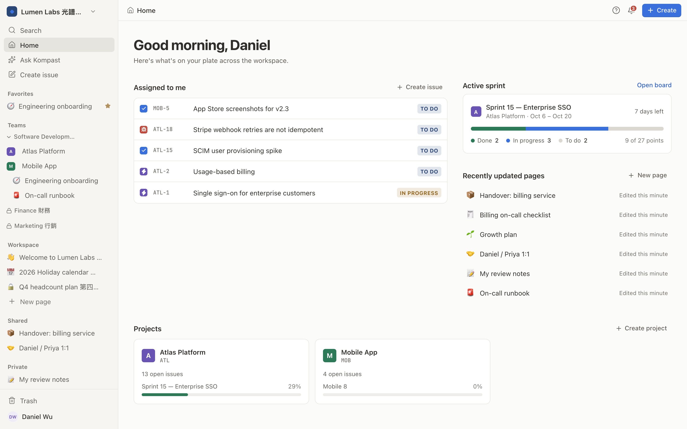
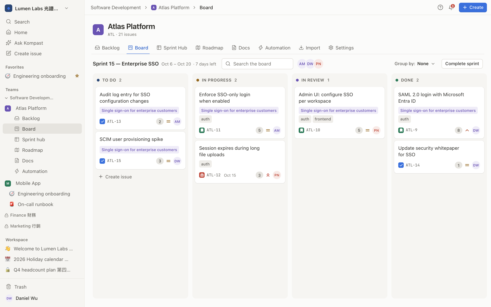
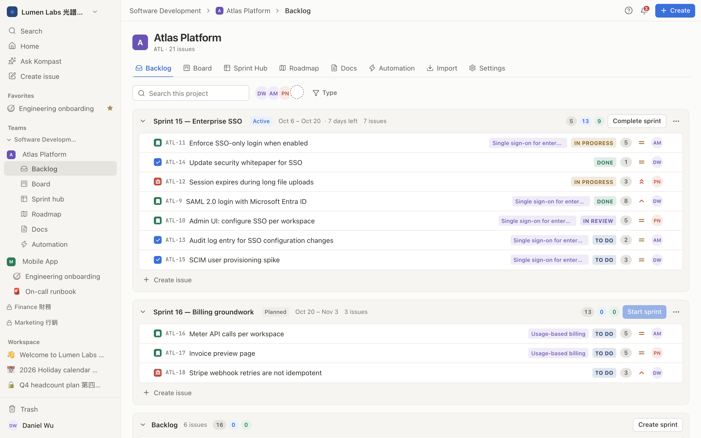
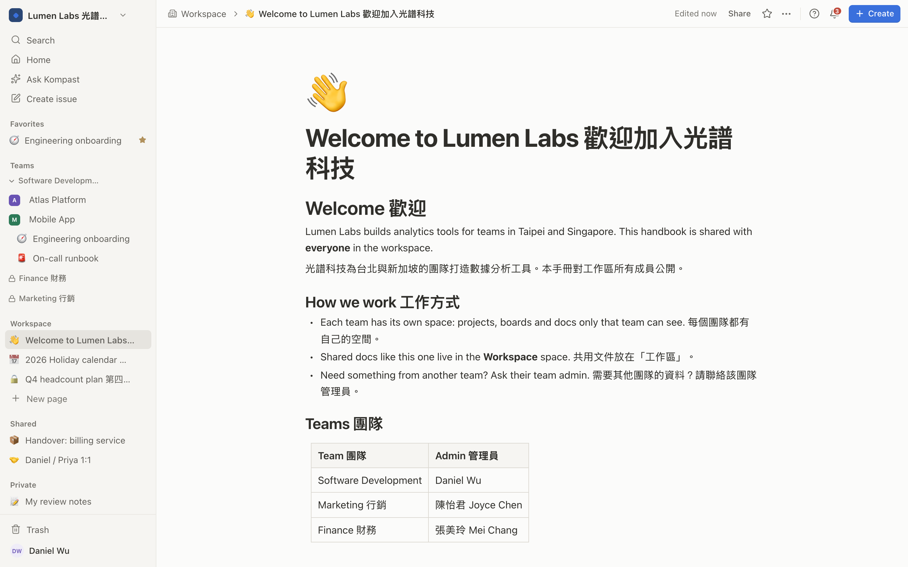
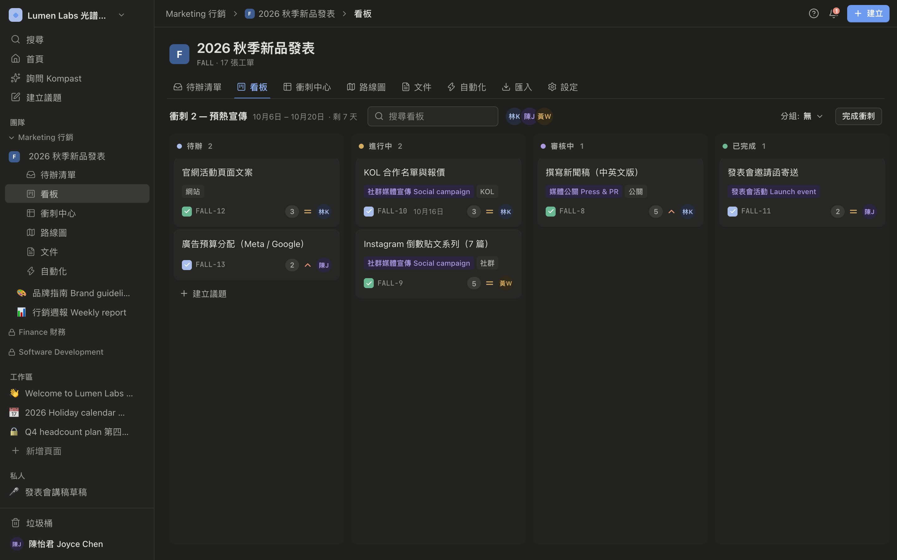
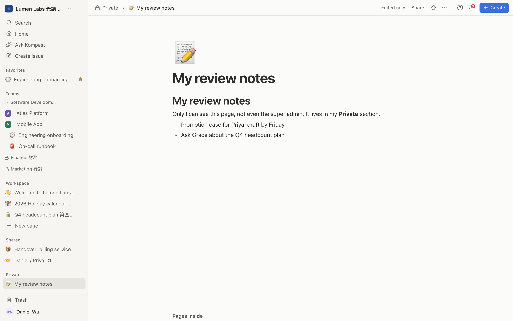
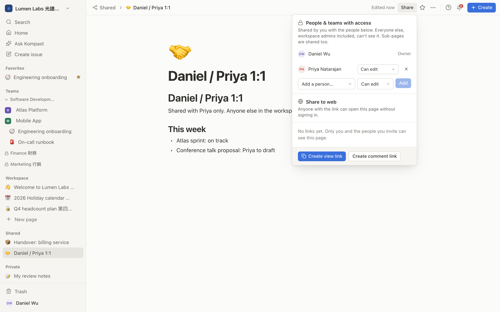
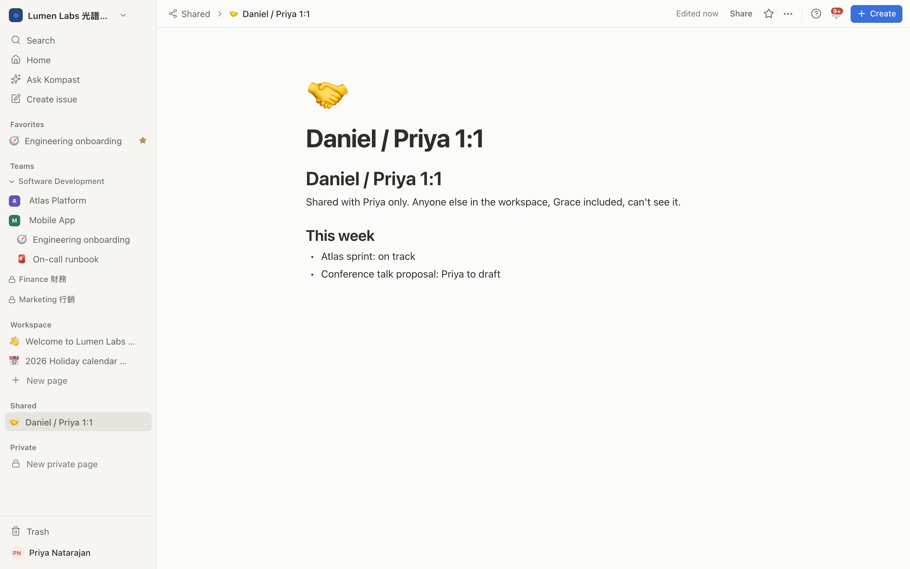
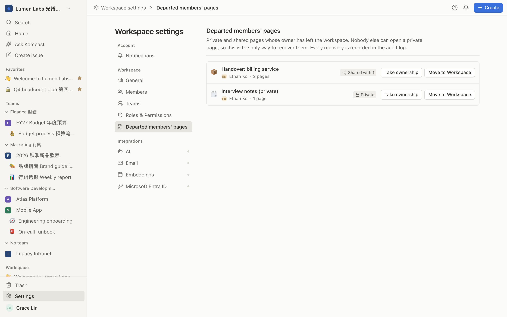

# Kompast

A self-hosted team workspace that brings docs, project tracking, automation, and AI assistance together in one place — instead of stitching together several disconnected tools. Real-time collaborative docs, kanban boards with configurable sprints, workflow automation, and an AI assist layer, all on one Postgres-backed workspace.

**Status**: the core platform — auth, boards, docs, REST/MCP API, sprints, notifications, automation, AI assist — is built and working. Data import currently supports JIRA; a general-purpose importer for other tools and a production-hardening pass are still ahead.

| Area | Status |
|---|---|
| Foundation, auth, kanban core | Done |
| Docs | Done |
| REST API + MCP | Done |
| Sprints + roadmap | Done |
| Notifications + mail | Done |
| Automation | Done |
| AI assist + Ask Kompast (RAG chat) | Done |
| Teams + team-scoped visibility | Done |
| Private & Shared docs (Notion-style) | Done |
| Importers | JIRA done, others not started |
| Hardening + cutover | Not started |

Implementation rationale, known gotchas, and verification write-ups for each area live in [`docs/ENGINEERING-NOTES.md`](docs/ENGINEERING-NOTES.md) — read the relevant section before touching that feature area.

## Screenshots

All taken from the seeded [demo workspace](docs/DEMO.md) (`pnpm demo`), "Lumen Labs 光譜科技".



| | |
|---|---|
|  |  |
| **Board.** The active sprint, with epics, labels, estimates and assignees. | **Backlog.** Plan the next sprint and start or complete sprints. |
|  |  |
| **Docs.** Real-time collaborative pages in a sidebar of spaces: teams, Workspace, Shared, Private. | **Localized and themed.** Marketing's board in Traditional Chinese, dark mode. |

### Private & Shared docs

Like Notion's sidebar, every member has a **Private** section that only they can see, workspace admins included. Inviting specific people moves a page to **Shared**. If someone leaves, the super admin can recover their private pages.

| | |
|---|---|
|  |  |
| **Private.** Daniel's review notes. Nobody else can open them, not even the super admin. | **Shared.** Daniel invites Priya to their 1:1 page, and its sub-pages come along. |
|  |  |
| **The invitee's view.** Priya sees the page under Shared. Other team members don't see it at all. | **Departed members' pages.** The super admin takes ownership of, or moves to the Workspace, the private pages of someone who left. Each recovery is audit-logged. |

## Stack

TanStack Start (React, SSR, Nitro `node-server`) · Better Auth (Microsoft Entra ID, `organization` = workspace, `apiKey` for PATs) · Drizzle + Postgres 17 (pgvector) · Redis · Google Cloud Storage · Tailwind v4 · BlockNote + Hocuspocus (Yjs) for real-time docs · pnpm workspaces + Turborepo.

## Repo layout

```
apps/web      UI, docs editor, guest share routes, REST API, MCP server
apps/collab   Hocuspocus (Yjs) server for real-time docs
apps/worker   BullMQ background jobs — mail, automation, reindexing
packages/core Domain service layer — every mutation lives here once
packages/ai   AI provider adapter (Anthropic / Azure OpenAI / OpenAI-compatible)
packages/db   Drizzle schema, migrations, RLS policies, tenant isolation
packages/ui   Design tokens + primitives
packages/env  Zod-validated environment config
infra/        Dockerfiles, docker-compose.yml, Caddyfile.example, .env.example
```

## Local development

Requires Node 22+, pnpm 10+, a Postgres 17 instance, and Redis.

```bash
pnpm install
cp infra/.env.example apps/web/.env   # infra secrets only — see below
pnpm --filter @kompast/db generate    # writes packages/db/drizzle/*.sql
pnpm --filter @kompast/db migrate     # applies it to DATABASE_URL
pnpm dev                              # apps/web (:3000) + apps/collab together
```

Or spin up throwaway Postgres/Redis containers automatically:

```bash
pnpm dev:docker      # creates/starts dev containers, then pnpm dev
pnpm dev:services    # just the containers
```

- Real-time docs need `apps/collab` running — `pnpm dev` starts both. Running `apps/web` alone will hang while the editor tries to sync.
- Business config (Entra ID, AI provider, mail vendor) is set through the app itself (`/setup`, `/settings`) — not `.env`. Only infra secrets go in `.env`, and the app refuses to boot if one is missing.
- `pnpm build` / `pnpm typecheck` / `pnpm test` run across the whole workspace.

## First run

Every route redirects to `/setup` until Microsoft Entra ID is configured:

1. Deploy with `.env` filled in and migrations applied.
2. Open the app — you land on `/setup`.
3. Enter your Entra ID app's **Tenant ID**, **Client ID**, and **Client Secret**. Register the redirect URI on the Azure app first: `https://<your-domain>/api/auth/callback/microsoft-entra-id`.
4. Submitting takes effect immediately, no restart needed. `/setup` then redirects to `/login` permanently — re-editing credentials later happens from `/settings`.
5. **The first person to sign in becomes the owner and super admin of a new workspace.** Everyone after that needs an invite: from a workspace admin (Settings → Members), or from a team admin straight into their team.

⚠️ A wrong Tenant ID — or a brief Microsoft outage — currently takes down the whole app at boot, with no UI-level fix. See `docs/ENGINEERING-NOTES.md` for the workaround.

## Workspace UI

A Notion-style sidebar (favorites; your teams, each with its projects and team docs; other teams as locked names; shared Workspace docs), a ⌘K command palette (jump to any project view, page, issue or person), a global Jira-style **Create issue** dialog (`C`), and keyboard shortcuts (`/` search, `⌘\` toggle sidebar, `?` shortcut list). Light and dark themes share one token set in `packages/ui/src/theme.css`; see `DESIGN.md`.

## Settings (`/settings`, admin-only)

Once a workspace exists, an admin can configure, without touching `.env`:
- **AI provider** — Anthropic, Azure OpenAI, or an OpenAI-compatible endpoint.
- **Mail vendor** — Brevo, Resend, or SMTP.
- **Embedding provider** (for Ask Kompast) — Azure OpenAI or OpenAI-compatible.

All secrets are encrypted at rest and never echoed back to the client.

## Features

**Teams & visibility** — the workspace is one organization, split into teams. The **super admin** (one per workspace, transferable) creates teams, appoints team admins, sees every team's content, and assigns legacy team-less projects to a team. **Team admins** create projects, add workspace members to their team, and invite new people by email straight into it. **Everyone else sees only their own teams' projects, issues, sprints and docs**, plus the shared Workspace docs. Other teams show as locked names, and a link to hidden content shows "not found, or no access". This is enforced by Postgres row-level security, so the UI, REST, MCP and Ask Kompast all honor it. Workspace owner/admin is a settings role, not a see-everything role.

**Docs** — Notion-style real-time collaborative pages (BlockNote + Hocuspocus) with emoji icons, nested page tree, favorites and breadcrumbs. Every page lives in a space (shared Workspace, a team, a project, or your own **Private** space) and can be moved between them. Like Notion, Private pages are visible to you alone, the super admin included. Invite specific people and the page moves to **Shared**, where only they can see it. If someone leaves the workspace, the super admin can recover their private pages from Settings (audit-logged). Per-page access lists (Share → People & teams with access), version history, templates, trash/restore, guest share links, `@mention` backlinks, and a live read-only board embed inside a doc.

**Boards & sprints** — Jira-style backlog (sprint containers with drag-and-drop between sprints and backlog, inline quick-create, start/complete sprint with carry-over), kanban boards with configurable sprint cycles and assignee swimlanes, a sprint hub table with inline-cell editing (status, assignee, priority, type, points, due date, title) and multi-column sort (incl. by epic and label), per-issue to-do checklists (Jira checklist-plugin style — check off/reorder on the issue page, progress badge + quick-edit popover on kanban cards), burndown/cumulative-flow reports, velocity history, and an epic roadmap timeline.

**REST API + MCP** — every mutation lives once in `packages/core`, so the UI, REST (`/api/v1`), and MCP (`/mcp`) can never drift apart in what they allow. Personal access tokens (`/tokens`) scope both surfaces.

```bash
claude mcp add --transport http kompast https://<domain>/mcp \
  --header "Authorization: Bearer kmp_…"
```

**Notifications & mail** — per-user, per-event preferences (in-app / email), transactional email delivery via a background queue; clicking a notification opens its issue/page. No digest batching or outbound webhooks yet.

**Automation** — an n8n-style visual node-graph workflow builder (React Flow canvas on each project's Automation tab): triggers (issue events or cron schedules), conditions (if/else and multi-way switch), actions (set property, label, comment, add/replace description, notify, link, create subtask, outbound webhook), a `find_issues` + `loop_each` pair for schedule-triggered workflows to act on a set of issues, and `{{trigger.payload.x}}` / `{{steps.<name>.output.x}}` expressions for passing data between nodes. Same guardrails as before (chain-depth limit, per-workflow rate limit, dry-run mode), now with per-node run history instead of one opaque log row. This replaced an earlier flat trigger+conditions+actions rule model in the same pass that shipped this canvas — see `docs/ENGINEERING-NOTES.md` for the migration/cutover.

**AI assist** — writing assist in the doc editor (continue/improve/shorten/expand/summarize/translate), AI-drafted issue descriptions, and AI sprint summaries. One provider adapter shared across features, usage logged per call.

**Ask Kompast** — a RAG chat over issue titles, descriptions, and comments (pgvector-backed semantic search). Docs/pages indexing is planned but not built yet.

**Importers** — a JIRA importer (live API or exported JSON) that's idempotent and safe to re-run, with a dry-run mode. No importer for other tools yet — that's the main remaining migration gap.

**Attachments** — pluggable storage (`local` for dev, Google Cloud Storage for production) behind one interface; file bytes never pass through the Node process for production uploads.

See `docs/ENGINEERING-NOTES.md` for what's deliberately out of scope in each area, and why.

## Stakeholder demo

A self-contained demo with six personas across an English software team and a Traditional Chinese marketing team. It needs no Entra, AI or mail setup.

```bash
pnpm demo                                   # on your laptop → http://localhost:3000, access code "kompast-demo"
cd infra && ./demo.sh init https://demo.example.com && ./demo.sh up   # on a server
```

See [`docs/DEMO.md`](docs/DEMO.md) for the personas, a presentation flow and the reset/status/logs commands.

## GCP storage setup

1. Enable the Cloud Storage API on your GCP project.
2. Create a private bucket (uniform access, no public bindings), regional close to your host.
3. Create a service account with `roles/storage.objectAdmin` scoped to that bucket only.
4. Download its JSON key to the host, outside the git-ignored build context (e.g. `/etc/kompast/gcs-service-account.json`, `chmod 600`).
5. Mount it read-only via `docker-compose.yml` at `/run/secrets/gcs.json`; set `GOOGLE_APPLICATION_CREDENTIALS`, `GCS_BUCKET`, `GCS_PROJECT_ID` in `.env`.
6. Apply CORS so direct browser→GCS uploads work:
   ```bash
   gcloud storage buckets update gs://<bucket> --cors-file=infra/gcs-cors.json
   ```
   Edit the `origin` field to your real domain first.

## Deploying

```bash
cd infra
cp .env.example .env   # fill in every value
docker compose pull
docker compose up -d
```

- Every service binds to `127.0.0.1` only — Caddy fronts them (see `infra/Caddyfile.example`). Route `/api/collab/*` to the `collab` service **before** the catch-all to `web`, or the Yjs WebSocket upgrade 404s.
- `migrate` is a one-shot service that runs before `web` starts: Drizzle migrations, then bootstraps the restricted `kompast_app` DB role, then applies RLS policies — in that order, every deploy. **This order matters**: Postgres exempts table owners from row-level security, so `DATABASE_URL` and `DATABASE_ADMIN_URL` must always be two different roles.
- Images are built and pushed to GHCR on every push to `main` and on version tags. Set `GHCR_OWNER` in `.env`.

### Backups

Nothing automated yet. At minimum, before going near real data: a `pg_dump` cron with off-box retention and a tested restore procedure.
