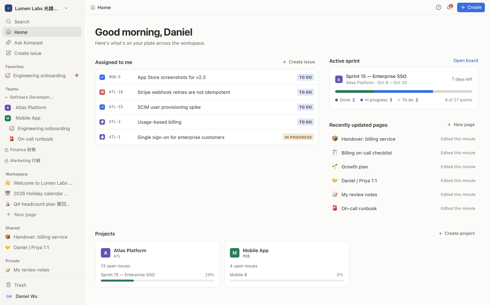
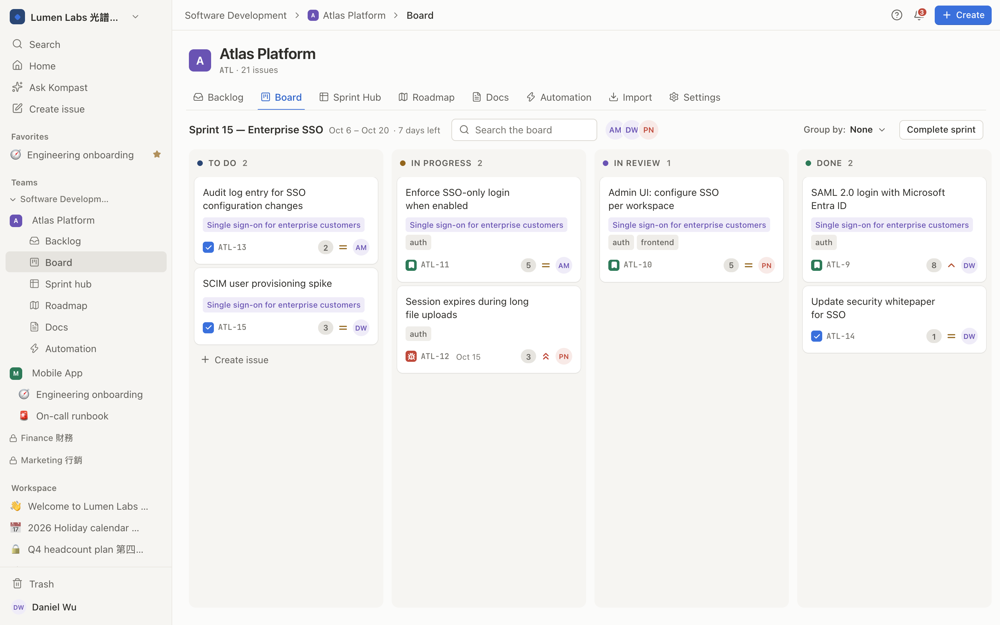
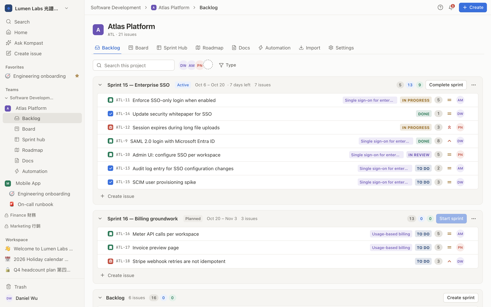
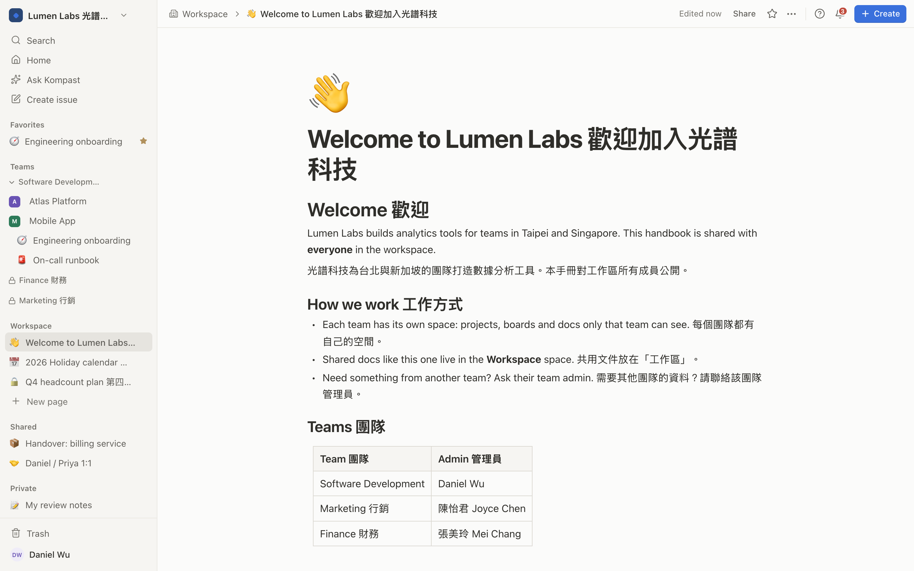
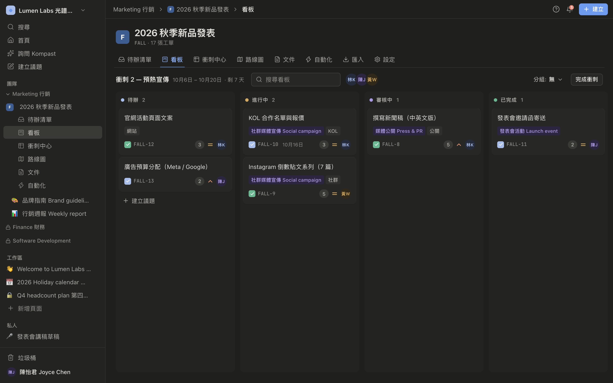
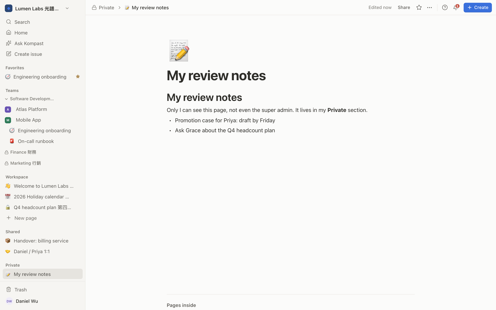
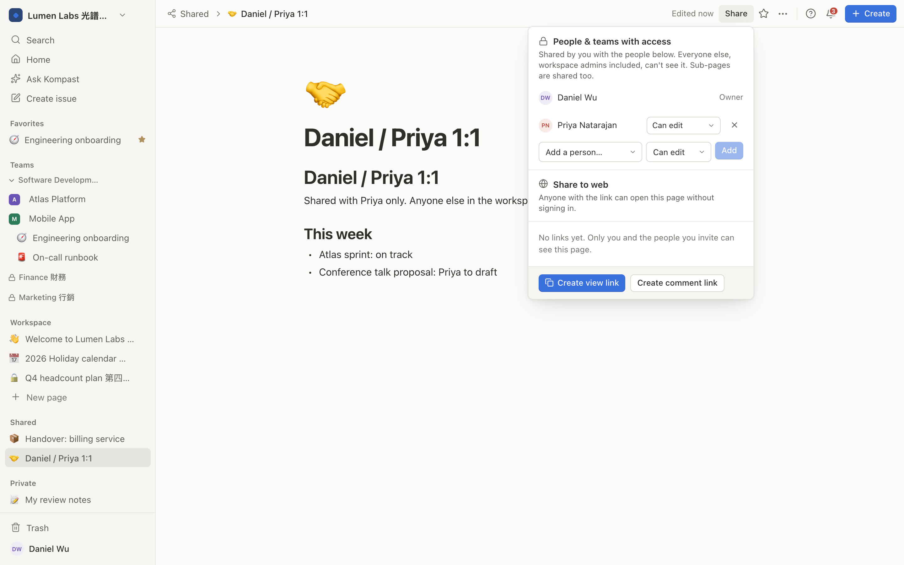

<div align="center">

# Kompast

**A self-hosted workspace for docs, projects and automation.**

Real-time collaborative docs, Jira-style boards and sprints, visual workflow automation and AI assistance, all in one Postgres-backed workspace.

[Features](#features) · [Screenshots](#screenshots) · [Quick start](#quick-start) · [Deployment](#deployment) · [API & MCP](#rest-api--mcp) · [Architecture](#architecture)

</div>

---

## Why Kompast

Most teams split their work across a docs tool and an issue tracker, then spend time keeping the two in sync. Kompast keeps both in one place: docs and issues share a workspace, link to each other, embed each other, and can be searched together. It runs on your own infrastructure, so your data stays with you.

- **Docs and issues together.** Live board embeds inside pages, doc↔issue links, backlinks and one search across both.
- **Self-hosted.** Docker Compose behind your own reverse proxy, with Postgres row-level security isolating every team's content.
- **One API surface.** The UI, the REST API and the MCP server all call the same domain layer, so they never disagree about what's allowed.
- **Configured in the app.** Single sign-on, AI provider, mail vendor and embeddings are set from the admin UI with no redeploy.

## Features

### Docs
- Real-time collaborative editing (BlockNote + Yjs) with a nested page tree, emoji icons, favorites and breadcrumbs.
- Spaces: shared **Workspace** docs, team and project docs, and a **Private** space visible only to you.
- Share a private page with specific people and it moves to **Shared**, sub-pages included.
- Per-page access lists, version history, templates, trash and restore, guest share links, `@mention` backlinks and live board embeds.

### Boards & sprints
- Backlog with sprint containers, drag-and-drop planning, inline quick-create and start/complete with carry-over.
- Kanban boards with configurable sprint cycles and assignee swimlanes.
- Sprint table with inline editing and multi-column sort.
- Per-issue checklists, worklogs, issue links and watchers.
- Burndown and cumulative-flow reports, velocity history and an epic roadmap.

### Automation
- A visual node-graph workflow builder on each project.
- Triggers on issue events or cron schedules; if/else and switch conditions.
- Actions to set fields, label, comment, notify, link, create subtasks and call outbound webhooks.
- Loop over query results and pass data between steps with `{{…}}` expressions.
- Guardrails built in: chain-depth limits, per-workflow rate limits, dry-run mode and per-node run history.

### AI
- **Writing assist** in the editor: continue, improve, shorten, expand, summarize, translate.
- AI-drafted issue descriptions and sprint summaries.
- **Ask Kompast**: a chat that answers questions from your issues, comments and docs. It uses pgvector semantic search plus read-only lookups (issues by status, assignee or sprint; issue details; sprint reports), and only ever sees what the person asking can see.
- Works with Anthropic, Claude on Azure AI Foundry, Azure OpenAI, or any OpenAI-compatible endpoint.

### Teams & access control
- One workspace split into teams. Members see only their own teams' projects, issues, sprints and docs, plus shared Workspace docs.
- A transferable super admin role, team admins who manage their own members, and invitations by email.
- Enforced by Postgres row-level security, so the UI, REST, MCP and AI chat all apply the same rules.
- Private pages left behind by departed members can be recovered by the super admin, and every recovery is audit-logged.

### Migration & import
- **JIRA Cloud migration wizard.** Map statuses, issue types, priorities, people and custom fields, then import in the background.
  - Issues keep their original keys and come with sprints, comments, history, worklogs, links, watchers and attachments.
  - Scheduled catch-up syncs pick up what changed in JIRA since the import.
  - A completeness check compares both sides before you finish.
- **JIRA importer** from the live API or an exported JSON file. It's idempotent and has a dry-run mode.
- **Notion importer**, two ways in. **Connect to Notion** (recommended): paste an internal integration token, pick the pages shared with it, choose where each one goes (Workspace, Private, or a team you're on), and Kompast copies them in the background, with progress and a report. Or **upload the export .zip** (HTML or Markdown & CSV). Both rebuild the page tree with formatting, tables, images and links between pages.

### And more
- Per-user, per-event notification preferences (in-app and email).
- A ⌘K command palette, a global quick-create dialog and keyboard shortcuts.
- Light and dark themes.
- UI in English, Bahasa Indonesia and Traditional Chinese.
- Pluggable file storage: local disk, or Google Cloud Storage with direct browser uploads.

## Screenshots



| | |
|---|---|
|  |  |
| **Board.** The active sprint, with epics, labels, estimates and assignees. | **Backlog.** Plan upcoming sprints, then start and complete them. |
|  |  |
| **Docs.** Real-time collaborative pages organized into spaces. | **Localized and themed.** Traditional Chinese, dark mode. |
|  |  |
| **Private pages.** Visible only to their author. | **Sharing.** Invite specific people to a page and its sub-pages. |

## Quick start

### Try the demo

The demo seeds a sample workspace with six personas across two teams. It doesn't need SSO, AI or mail configuration.

```bash
pnpm install
pnpm demo        # http://localhost:3000 — access code: kompast-demo
```

See [`docs/DEMO.md`](docs/DEMO.md) for the personas, a suggested walkthrough and hosting the demo on a server.

### Local development

**Requirements:** Node.js 22+, pnpm 10+, PostgreSQL 17 with pgvector, and Redis 7.

```bash
pnpm install
cp infra/.env.example apps/web/.env    # fill in infrastructure values
pnpm db:migrate                        # apply migrations and RLS policies
pnpm dev                               # web app (:3000) + collaboration server
```

To have Postgres and Redis started in containers for you:

```bash
pnpm dev:docker      # start dev containers, then run the app
pnpm dev:services    # start only the containers
```

Notes:
- `pnpm dev` starts both the web app and the real-time collaboration server. Docs editing needs both running.
- Only infrastructure secrets (database, Redis, auth secret, storage) go in `.env`. The app validates them at startup and refuses to boot if one is missing.
- `pnpm build`, `pnpm typecheck` and `pnpm test` run across the whole workspace. Tests run against real Postgres and Redis instances.

## Deployment

Kompast ships as Docker images (`web`, `collab`, `worker`, `migrate`) published to GitHub Container Registry.

### Installer (recommended)

On a fresh Debian or Ubuntu VM (x86_64, e.g. a GCP Compute Engine instance), as root. No clone needed:

```bash
curl -fsSL https://github.com/rosdyana/kompast/releases/latest/download/install.sh | sudo bash
```

This installs the latest **release**: the installer downloads that release's runtime files, checks each one against its `SHA256SUMS`, and pins `IMAGE_TAG` to the release version. To check the installer itself before running it as root:

```bash
curl -fsSLO https://github.com/rosdyana/kompast/releases/latest/download/install.sh
curl -fsSLO https://github.com/rosdyana/kompast/releases/latest/download/SHA256SUMS
sha256sum --check --ignore-missing SHA256SUMS && sudo bash install.sh
```

Pin a specific release with `KOMPAST_VERSION=v0.4.0` (use `sudo -E`). For a private fork, export a `GITHUB_TOKEN` with read access and fetch the release with the GitHub CLI:

```bash
export GITHUB_TOKEN=ghp_...
gh release download -R <owner>/<repo> -p install.sh -p SHA256SUMS
sha256sum --check --ignore-missing SHA256SUMS && sudo -E bash install.sh
```

Or from a clone, which copies its `infra/` files instead of downloading them:

```bash
git clone https://github.com/rosdyana/kompast.git && cd kompast
sudo ./infra/install.sh
```

- Preflight checks (OS, RAM, disk, ports, Docker versions, GCP metadata, GHCR). Nothing changes until they pass. `--check` runs only this.
- Installs Docker and Caddy (automatic HTTPS) if you agree, checks that port 80 actually reaches the VM, and writes `.env` (chmod 600) with generated secrets.
- Shows your answers for review before writing anything. `--reconfigure` changes domain, storage, proxy or backups later, keeping the secrets.
- Pulls the images, runs migrations, starts the stack and waits until the app answers. Re-running upgrades: it backs up the database first, records the previous `IMAGE_TAG`, and moves `IMAGE_TAG` to the release being installed. `kompast upgrade` fetches the latest release's `install.sh` and verifies it against `SHA256SUMS` before running it (`KOMPAST_VERSION=vX.Y.Z kompast upgrade` pins one).
- Installs the daily Postgres backup and the `kompast` command. Logs go to `/var/log/kompast-install.log`.

Files live in `/opt/kompast` by default (`KOMPAST_DIR`). For unattended runs (a GCE startup script), pre-answer with `KOMPAST_*` variables and `--yes`, for example `KOMPAST_DOMAIN=kompast.example.com KOMPAST_STORAGE=local sudo -E ./infra/install.sh --yes`. `sudo ./infra/install.sh --help` lists every variable.

Day-to-day, through the `kompast` command:

```bash
kompast status | logs [svc] | restart [svc]
kompast upgrade          # re-run the installer; backs up first
kompast reconfigure      # change domain, storage, proxy or backups
kompast version          # IMAGE_TAG and running image digests
kompast backup | backups | restore <file>
kompast cleanup          # prune dangling images, show disk use
```

### Manual install

### Installer (recommended)

On a fresh Debian or Ubuntu VM (x86_64, e.g. a GCP Compute Engine instance), as root. No clone needed:

```bash
curl -fsSL https://github.com/rosdyana/kompast/releases/latest/download/install.sh | sudo bash
```

This installs the latest **release**: the installer downloads that release's runtime files, checks each one against its `SHA256SUMS`, and pins `IMAGE_TAG` to the release version. To check the installer itself before running it as root:

```bash
curl -fsSLO https://github.com/rosdyana/kompast/releases/latest/download/install.sh
curl -fsSLO https://github.com/rosdyana/kompast/releases/latest/download/SHA256SUMS
sha256sum --check --ignore-missing SHA256SUMS && sudo bash install.sh
```

Pin a specific release with `KOMPAST_VERSION=v0.4.0` (use `sudo -E`). For a private fork, export a `GITHUB_TOKEN` with read access and fetch the release with the GitHub CLI:

```bash
export GITHUB_TOKEN=ghp_...
gh release download -R <owner>/<repo> -p install.sh -p SHA256SUMS
sha256sum --check --ignore-missing SHA256SUMS && sudo -E bash install.sh
```

Or from a clone, which copies its `infra/` files instead of downloading them:

```bash
git clone https://github.com/rosdyana/kompast.git && cd kompast
sudo ./infra/install.sh
```

- Preflight checks (OS, RAM, disk, ports, Docker versions, GCP metadata, GHCR). Nothing changes until they pass. `--check` runs only this.
- Installs Docker and Caddy (automatic HTTPS) if you agree, checks that port 80 actually reaches the VM, and writes `.env` (chmod 600) with generated secrets.
- Shows your answers for review before writing anything. `--reconfigure` changes domain, storage, proxy or backups later, keeping the secrets.
- Pulls the images, runs migrations, starts the stack and waits until the app answers. Re-running upgrades: it backs up the database first, records the previous `IMAGE_TAG`, and moves `IMAGE_TAG` to the release being installed. `kompast upgrade` fetches the latest release's `install.sh` and verifies it against `SHA256SUMS` before running it (`KOMPAST_VERSION=vX.Y.Z kompast upgrade` pins one).
- Installs the daily Postgres backup and the `kompast` command. Logs go to `/var/log/kompast-install.log`.

Files live in `/opt/kompast` by default (`KOMPAST_DIR`). For unattended runs (a GCE startup script), pre-answer with `KOMPAST_*` variables and `--yes`, for example `KOMPAST_DOMAIN=kompast.example.com KOMPAST_STORAGE=local sudo -E ./infra/install.sh --yes`. `sudo ./infra/install.sh --help` lists every variable.

Day-to-day, through the `kompast` command:

```bash
kompast status | logs [svc] | restart [svc]
kompast upgrade          # re-run the installer; backs up first
kompast reconfigure      # change domain, storage, proxy or backups
kompast version          # IMAGE_TAG and running image digests
kompast backup | backups | restore <file>
kompast cleanup          # prune dangling images, show disk use
```

### Manual install

```bash
cd infra
cp .env.example .env   # fill in every value
docker compose pull
docker compose up -d
```

- **Reverse proxy.** Services bind to `127.0.0.1`; put a reverse proxy in front (see [`infra/Caddyfile.example`](infra/Caddyfile.example)). Route `/api/collab/*` to the `collab` service *before* the catch-all route to `web`, or the WebSocket upgrade fails.
- **Migrations.** The one-shot `migrate` service runs before `web` on every deploy. It applies schema migrations, provisions a restricted application role, then applies row-level security policies.
- **Database roles.** Three roles, each **its own user**:
  - `DATABASE_ADMIN_URL`: the owner/superuser. Only the `migrate` service gets it; compose blanks it for web, collab and worker.
  - `DATABASE_URL` (`kompast_app`): every normal request, subject to row-level security. Postgres exempts table owners from RLS, so it must not be the admin role.
  - `DATABASE_SERVICE_URL` (`kompast_service`): the few deliberate RLS-exempt paths (collab persistence, guest share links, worker queue claims). `BYPASSRLS` with data-only grants, not a superuser. `migrate` creates it.

  `kompast upgrade` adds `DATABASE_SERVICE_URL` to installs that predate it. On managed Postgres that can't grant `BYPASSRLS`, set `DATABASE_SERVICE_URL` to the admin URL; the app then falls back to the old behavior.
- **Backups.** `infra/backup.sh` runs a daily `pg_dump` at 02:30 (cron, installed by the installer) into `BACKUP_DIR` (default `/var/backups/kompast`), keeps `BACKUP_RETENTION_DAYS` (default 14) days of local dumps, and copies to `BACKUP_GCS_URI` when you choose `local+gcs`. `sudo ./infra/backup.sh restore <file>` restores one after you type the database name to confirm, then re-runs `migrate` to re-apply roles and RLS. Test a restore before you need one. Local-only backups die with the VM disk, so consider a GCE snapshot schedule (the installer prints the commands).

### First run

Until single sign-on is configured, every route redirects to `/setup`.

1. Register an app in **Microsoft Entra ID** with the redirect URI `https://<your-domain>/api/auth/callback/microsoft-entra-id`.
2. Open Kompast and enter the **Tenant ID**, **Client ID** and **Client Secret** on `/setup`. Changes apply immediately, with no restart.
3. **The first person to sign in becomes the workspace owner and super admin.** Everyone else joins by invitation from a workspace or team admin.

> [!IMPORTANT]
> Kompast loads Entra ID configuration at startup. An incorrect Tenant ID can stop the app from booting, so double-check it before you save.

### Admin settings

Workspace admins can change these at `/settings` without touching `.env`:

| Setting | Options |
|---|---|
| Single sign-on | Microsoft Entra ID |
| AI provider | Anthropic, Claude on Azure AI Foundry, Azure OpenAI, OpenAI-compatible |
| Embedding provider (Ask Kompast) | Azure OpenAI, OpenAI-compatible |
| Mail vendor | Brevo, Resend, SMTP |

Secrets are encrypted at rest and never sent back to the browser.

### Google Cloud Storage (optional)

1. Create a private bucket with uniform access, close to your host.
2. Create a service account with `roles/storage.objectAdmin` on that bucket only, and download its JSON key.
3. Mount the key read-only into the containers (see `docker-compose.yml`). Then set `GOOGLE_APPLICATION_CREDENTIALS`, `GCS_BUCKET` and `GCS_PROJECT_ID` in `.env`.
4. Allow direct browser uploads. Set your domain in `infra/gcs-cors.json`'s `origin` field first, then run:
   ```bash
   gcloud storage buckets update gs://<bucket> --cors-file=infra/gcs-cors.json
   ```

## REST API & MCP

The UI, the REST API (`/api/v1`) and the MCP server (`/mcp`) all call the same domain layer, so all three enforce the same permissions. Create a personal access token at `/tokens`. A token can grant a subset of your own permissions, never more than you have.

Connect an MCP client such as Claude Code:

```bash
claude mcp add --transport http kompast https://<your-domain>/mcp \
  --header "Authorization: Bearer kmp_…"
```

MCP tools cover:
- Issues, including checklists, worklogs, links, watching and archive.
- Sprints and their reports.
- Docs: read as Markdown, search, move, duplicate, versions, comments and access.
- Automation workflows and notifications.

## Architecture

| Layer | Technology |
|---|---|
| Web app | TanStack Start (React, SSR), Tailwind CSS v4 |
| Real-time docs | BlockNote + Hocuspocus (Yjs) |
| Auth | Better Auth: Microsoft Entra ID, organizations, API keys |
| Data | PostgreSQL 17 + pgvector, Drizzle ORM, row-level security |
| Jobs | Redis + BullMQ |
| Storage | Local disk or Google Cloud Storage |
| Tooling | pnpm workspaces, Turborepo, Vitest |

```
apps/
  web        UI, REST API, MCP server, guest share routes
  collab     Real-time collaboration server (Hocuspocus)
  worker     Background jobs: mail, automation, sync, reindexing
packages/
  core       Domain logic and permission checks; every mutation lives here
  db         Schema, migrations, row-level security policies
  ai         AI provider adapters
  mail       Mail vendor adapters
  storage    File storage adapters
  import     JIRA and Notion importers
  i18n       Translations
  ui         Design tokens and UI primitives
  env        Validated environment config
infra/       Dockerfiles, Docker Compose, Caddy example
```

For implementation details and design decisions, see [`docs/ENGINEERING-NOTES.md`](docs/ENGINEERING-NOTES.md).

## Roadmap

- Importers for more tools.
- Notification digests.
- Production hardening.

## License

[MIT](LICENSE) © 2026 Rosdyana Kusuma
